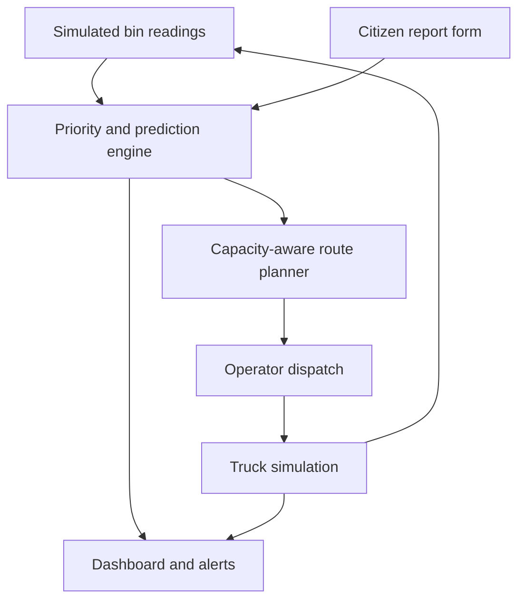
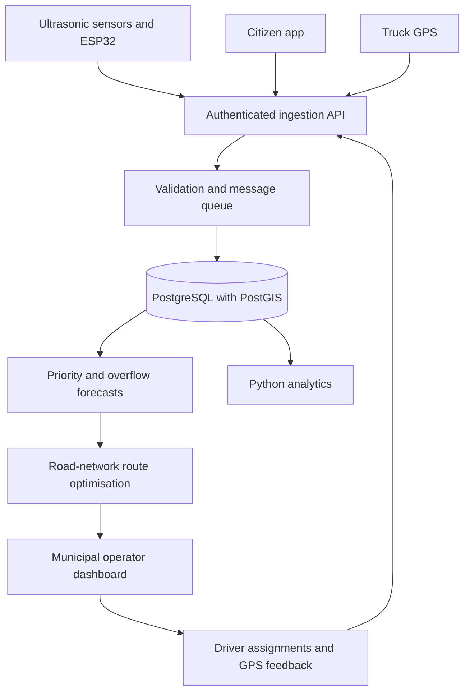

# Binwise technical architecture

## Working prototype

React + Vite runs entirely in the browser. `src/engine.js` contains the deterministic sensor model, score, forecast, dispatcher and minute-by-minute truck simulation. `src/main.jsx` supplies five operator views. State persists in browser localStorage under `binwise-v1`; no credentials, real sensors, server, real citizen submissions or GPS feeds are involved.



## Proposed production deployment



Candidate technology choices, not integrations delivered in this prototype:

| Layer | Candidate implementation | Purpose |
|---|---|---|
| Sensors | Ultrasonic distance sensor + ESP32, enclosure and battery health monitoring | Estimate free space after calibration for bin geometry |
| Connectivity | LoRaWAN through ward gateways, or NB-IoT / 4G where appropriate | Send timestamped readings and device-health signals |
| Ingestion | Node.js or Python service with authenticated MQTT / HTTPS | Validate range, freshness, identities and duplicate packets |
| Database | PostgreSQL + PostGIS | Store bins, readings, reports, truck positions and audit trails |
| Planning | Capacity/time-window vehicle-routing solver using a road-network travel-time matrix | Incorporate traffic, depot unloading, shifts and waste compatibility |
| Maps | Leaflet with an appropriately licensed OpenStreetMap tile provider and routing service | Real streets, access restrictions and driver navigation |
| UI | React municipal console and mobile driver/citizen views | Human-approved dispatch and collection evidence |
| Analytics | Python jobs and SQL aggregates | Evaluate service reliability, total distance and operating costs |

Production controls: per-device credentials, TLS, operator role-based access, audit logs, report moderation, rate limits, sensor-freshness alerts, maintenance queues, offline driver support and a safe fallback collection schedule. Avoid collecting resident identity unless needed for follow-up. Waste streams need compatible trucks and disposal destinations. Calibrate volume-to-mass conversions before enforcing real legal payload limits.

## Priority and prediction specification

All volume quantities are litres. Fill may exceed 100% to represent nearby overflow, capped at 150% for visual demonstration. Any extra growth beyond that cap is intentionally not tracked. Synthetic locations are approximate, not surveyed bin positions.

`hours_until_full = max(0, (1 - fill/100) * capacity / rate)`.

Zero accumulation gives infinite time-to-full, while fill >= 100 remains critical regardless of score. For positive rates, the score is:

```
35 × min(fill/100, 1)
+ 25 × max(0, 1 − hours_until_full/8)
+ 10 × min(hours_since_collection/48, 1)
+ 10 × min(rate/35, 1)
+ 10 × area_activity
+ 10 × min(capacity/1000, 1)
+ min(15, 8 × open_report_count)
```

Cap the total at 100 and round it. Area activity is a synthetic 0–1 value. Weights are explainable design assumptions, not learned or validated parameters.

- Critical: fill >= 95% or time to full <= 2 hours.
- High priority: score >= 60 or time to full <= 8 hours.
- Collection soon: score >= 40 or time to full <= 16 hours.
- Normal: otherwise.
- Select Critical and High priority bins, plus bins with open overflow, missed-collection or illegal-dumping reports. A damaged-bin report raises the score but remains open after collection for maintenance follow-up.

## Dispatch and simulation

Take available trucks only. Exclude bins already reserved by an active truck. At each step, discard candidates that exceed remaining truck volume. Rank critical bins first, then maximise `priority_score − 4 × distance_km`. This is a simple priority-weighted nearest-neighbour heuristic. Assign remaining candidates to the next available truck. Unassigned bins remain visible. The baseline uses the same capacity restrictions but visits all bins in ID order. It is an illustrative fixed schedule, not an optimised best-case comparator.

Distances use Haversine great-circle distance × 1.3. Both plans include a depot return, assume 18 km/h and six minutes per stop, and estimate fuel at 3.5 km/L. Cost assumes ₹95/L; this is a demonstration input, not a claim about current pump prices. Trucks start at the depot with 6,000 L usable volume. The fourth truck is in maintenance.

Each simulation minute adds waste and progresses truck travel/service time. A truck picks up only what fits at arrival, leaving excess behind. Completed collection resolves waste-related reports, while damaged-bin reports remain open. A full truck returns to unload. Once back at the depot it becomes available. No automatic second dispatch occurs: the operator reviews the next recommendation.

Limitations: prediction assumes a constant rate; route planning does not explicitly optimise arrival before overflow deadlines; congestion, unloading time, shift limits, narrow roads, vehicle mass limits, waste-stream compatibility and sensor errors need production treatment. Live distance includes completed legs only. At-risk bins serviced is a proxy, not a causal overflow-prevention claim. A dispatch comparison defers some service, so it does not establish full-day savings.
